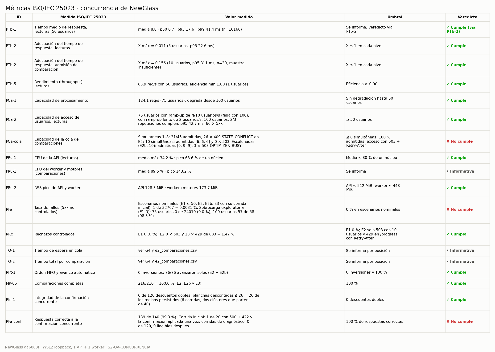

# Evidencia S2-QA-CONCURRENCIA — Concurrencia de NewGlass medida con Locust

| Campo | Valor |
|---|---|
| SPEC | [SPEC-S2-QA-CONCURRENCIA.md](SPEC-S2-QA-CONCURRENCIA.md) (v1.2, *Implemented*) |
| Código medido | `newglass-backend` `main` en `aa6883f888a2fa43629ed9d7f6110ca3645887e4`, copiado con `git archive` (solo lectura) |
| Fecha | 25/11/2026 |
| Responsable | Fabricio Danniel Aguilar Chavez (`fabrilar1`) |
| Ubicación | `newglass-backend` `docs/evidence/sprint-02/QA-CONCURRENCIA/`, rama `test/S2-QA-concurrencia-locust` (SPEC D-08) |
| Características ISO/IEC 25010:2023 | Eficiencia de desempeño (comportamiento temporal, utilización de recursos, capacidad) con apoyo de Fiabilidad (ausencia de fallos, tolerancia a fallos) |

## 1. Resumen

- **Lecturas (E1):** con 1 a 50 usuarios simultáneos el p95 se mantuvo entre 15 y 23 ms
  (objetivo: 2000 ms), sin errores, y el rendimiento acompañó la demanda (83,9 req/s con
  50 usuarios). Con 75 usuarios todavía cumple (p95 26,3 ms, 124 req/s). **Con 100 usuarios
  colapsa** en las 3 repeticiones: se agota el pool de conexiones de SQLAlchemy (5 conexiones,
  sin overflow, espera de 30 s) y el 98 % de las respuestas son 500. **PCa-2 = 75 usuarios**
  (con ramp-up de N/10 usuarios/s). Con un ramp-up lento (E1-S), 100 usuarios cumplen en 2 de 3
  repeticiones y colapsan en la tercera: es un límite metaestable, no solo la ráfaga de logins (§6.2).
- **Cola de comparaciones (E2/E2b):** orden FIFO sin inversiones, avance automático en el
  100 % de los casos y 216/216 comparaciones completas con los seis motores (E2, E2b y E3). Pero cuando 4 o
  más personas envían **a la vez**, entre el 25 % y el 46 % recibe **409 `STATE_CONFLICT`** en
  lugar de entrar a la cola, así que la cola de 8 nunca se llena. Con envíos escalonados entran
  9 (1 en ejecución + 8 en espera) y la décima recibe 503 `OPTIMIZER_BUSY` con `Retry-After`.
- **Confirmación concurrente (E3):** **0 descuentos dobles en 140 repeticiones**. En 1 de 140
  (corrida inicial) las dos sesiones recibieron error (500 y 422) aunque la confirmación sí se
  aplicó una vez; no se volvió a reproducir en 120 repeticiones con diagnóstico ampliado.
- **Recursos:** la API no pasó de 131 MiB de RSS ni el worker (con sus motores) de 174 MiB;
  la CPU media de la API fue 34 % de un núcleo con 50 usuarios.

## 2. Entorno exacto

| Elemento | Valor |
|---|---|
| Anfitrión | Windows 11 Pro 10.0.26300, 15,7 GB de RAM |
| Sistema de prueba | WSL2, Ubuntu 24.04.4 LTS, kernel `6.18.33.2-microsoft-standard-WSL2` |
| CPU | Intel Core i9-14900HX, 32 CPU lógicas visibles en WSL2 |
| RAM de WSL2 | 7,61 GiB |
| Python | 3.12.3 (producción declara 3.11.9; SPEC D-02). Pines de `requirements.txt` sin cambios |
| PostgreSQL | 16.15, clúster temporal propio por escenario, solo `127.0.0.1`, borrado al terminar |
| Locust | 2.37.10 (un proceso, `HttpUser`), matplotlib 3.10.3, psutil 7.0.0 |
| API | `uvicorn main:app --host 127.0.0.1 --workers 1` (el `Procfile`, en loopback), Uvicorn 0.54.0, pool por defecto: 5 conexiones, overflow 0, espera 30 s |
| Worker | `python -m app.modules.optimization.worker_v2`, piloto durable activado, 1 plaza |
| Configuración | Valores por defecto: cola de 8, 1 supervisor activo, 4 lectores y 24 lecturas/s de progreso, límite de login de EN-SEC-001 |
| Muestreo | psutil cada 200 ms sobre la API y el worker con sus descendientes (excluye PostgreSQL y Locust) |

Datos sintéticos: 241 cuentas (80 por rol, 10 Operarios para E2 y 1 Operario dueño para E3),
300 pedidos de lectura, 40 clientes, 60 planchas y 120 retazos; en E2, un pedido de 50 piezas de
100 × 100 mm por cuenta sobre una plancha de 1000 × 1000 mm (el fixture de Andro); en E3, 60 pedidos
de 10 piezas. La contraseña sintética y `SECRET_KEY` se generaron en memoria y no se guardaron.

## 3. Escenarios ejecutados

| Escenario | Niveles | Repeticiones | Corridas | Notas |
|---|---|---:|---:|---|
| E1 lecturas | 1, 5, 10, 25, 50 usuarios | 3 | 15 | Ramp-up ≤ 10 s, ventana estable de 63–73 s (≥ 60 s), reflexión 0,2–1,0 s, roles 3:3:4 |
| E1-R *(exploratorio)* | 75, 100 usuarios | 3 | 6 | Pila nueva (API, worker y base) por repetición + sonda de recuperación |
| E1-S *(exploratorio)* | 100 usuarios, ramp-up de 2 usuarios/s | 3 | 3 | Separa "100 usuarios" de "ráfaga de logins" |
| E1-X *(primer intento, descartado)* | 100, 200, 400 | 3 | 9 | Una sola API para las 9 corridas: desde la segunda corrida arrastra el bloqueo anterior. Se conserva como evidencia del colapso |
| E2 comparaciones V2 | 1, 2, 4, 8, 10 simultáneos | 3 | 15 | Barrera de inicio; sondeo de `/progress` según `poll_after_ms`; liberación al final |
| E2b *(exploratorio)* | 10, escalonados cada 400 ms | 3 | 3 | Para observar la cola llena sin choques de admisión |
| E3 confirmación | 2 sesiones del mismo dueño | 20 por corrida | 6 + 1 inicial | 140 repeticiones verificadas en PostgreSQL |

Cada corrida guarda los CSV y el HTML de Locust, el registro propio por petición y el muestreo
de recursos (ver §11).

## 4. Métricas ISO/IEC 25023: valor y veredicto



| ID | Medida | Fórmula | Resultado | Umbral | Veredicto |
|---|---|---|---|---|---|
| PTb-1 | Tiempo de respuesta, lecturas (50 usuarios) | media = Σt/n; pXX = t[⌈p·n⌉] | media 8,8 · p50 6,7 · p95 17,6 · p99 41,4 ms (n = 16 160) | Se informa | Cumple (vía PTb-2) |
| PTb-2 | Adecuación del tiempo de respuesta, lecturas | X = p95 / 2000 ms | X máx = 0,011 (5 usuarios, p95 22,6 ms) | X ≤ 1 | **Cumple** |
| PTb-2 | Adecuación del tiempo de respuesta, admisión | X = p95 admisión / 2000 ms | X máx = 0,156 (10 usuarios, p95 311 ms; n = 30, muestra insuficiente) | X ≤ 1 | **Cumple** |
| PTb-5 | Rendimiento, lecturas | X = completadas / ventana; eficiencia = X / (N / (0,6 s + t̄₁)) | 83,9 req/s con 50 usuarios; eficiencia ≥ 1,00 en 1–50 | Eficiencia ≥ 0,90 | **Cumple** |
| PCa-1 | Capacidad de procesamiento | máx PTb-5 sin degradar | **124,1 req/s (75 usuarios)**; degrada desde 100 | Sin degradación hasta 50 | **Cumple** |
| PCa-2 | Capacidad de acceso de usuarios | máx N con p95 ≤ objetivo y 0 % de 5xx en 3/3 | **75 usuarios** (falla con 100 en 3/3; con ramp-up lento, 100 usuarios falla en 1/3) | ≥ 50 | **Cumple** |
| PCa-cola | Capacidad de la cola | 201 / 409 / 503 por nivel | Simultáneas 1–8: 31/45 admitidas, 26 × 409; 10 simultáneas: 6 por repetición y 0 × 503. Escalonadas: 9 por repetición y 3 × 503 | ≤ 8 simultáneas: 100 % admitidas | **No cumple** |
| PRu-1 | CPU de la API | ΔCPU del árbol / Δt × 100 | media máx 34,2 % (50 usuarios) · pico 63,6 % | Media ≤ 80 % de un núcleo | **Cumple** |
| PRu-1 | CPU del worker y motores | ídem | media 89,5 % · pico 143,2 % | Se informa | Informativa |
| PRu-2 | RSS pico | máx Σ RSS del árbol | API 128,3 MiB · worker + motores 173,7 MiB | API ≤ 512; worker ≤ 448 MiB | **Cumple** |
| RFa | Tasa de fallos | 5xx no controlados / total | Nominal: 1 de 32 707 (0,0031 %), el 500 de E3. Sobrecarga (E1-R): 75 usuarios 0 %; 100 usuarios 57 de 58 | 0 % nominal | **No cumple** |
| RRc | Rechazos controlados | (503 + 429) / total | E1: 0 %. E2: 0 × 503 y 13 × 429 (`/progress`, 10 usuarios) de 883 = 1,47 %, todos con `Retry-After` | Solo donde se esperan | **Cumple** |
| TQ-1 | Espera en cola | t(RUNNING) − t(WAITING) | Posición 1: 0,3 s · 2: 4,5 s · … · 9: 34,2 s (≈ 4,3 s por posición) | Se informa | Informativa |
| TQ-2 | Tiempo total por comparación | t(TERMINAL) − t(WAITING) | Posición 1: 4,2 s · 6: 25,9 s · 9: 38,2 s; cada comparación ejecuta en 3,1–4,7 s | Se informa | Informativa |
| RFt-1 | FIFO y avance automático | inversiones; avanzadas / admitidas | 0 inversiones; 76/76 avanzaron solas (E2 + E2b) | 0 y 100 % | **Cumple** |
| MP-05 | Comparaciones completas | COMPLETADA con 6 motores / admitidas | 216/216 = 100 % (E2, E2b y E3) | 100 % | **Cumple** |
| RIn-1 | Integridad de la confirmación concurrente | efecto ≠ una confirmación | **0 de 120** descuentos dobles (diagnóstico) + 0 de 20 (inicial); Δ planchas = recibos | 0 | **Cumple** |
| RFa-conf | Respuesta correcta a la confirmación concurrente | una 200 y una 409 sin efecto / total | 139 de 140 (99,3 %): 1 caso con 500 + 422 y la confirmación aplicada | 100 % | **No cumple** |

Notas: los percentiles de E2 tienen menos de 100 observaciones por nivel (MP-03): se informan
como "muestra insuficiente". La CPU se expresa en % de un núcleo (100 % = un núcleo completo).

## 5. Gráficos

| Gráfico | Qué muestra |
|---|---|
| [G1 · p50/p95/p99 vs usuarios](graficos/G1_e1_latencia_p95.png) | Lecturas planas hasta 75 usuarios y salto a ~61 s con 100 (ramp-up de 10/s); línea del objetivo de 2000 ms. |
| [G2 · Throughput vs usuarios](graficos/G2_e1_throughput.png) | El rendimiento sigue la demanda ofrecida hasta 75 y cae a 0,2 req/s con 100. |
| [G3 · Errores y rechazos](graficos/G3_errores_y_rechazos.png) | 5xx de E1 por nivel; respuestas 201/409/503/429 de E2 y E2b. |
| [G4 · Espera y total por posición](graficos/G4_e2_cola_por_posicion.png) | Crecimiento lineal de ~4,3 s por posición; E2 simultáneo y E2b escalonado. |
| [G5 · CPU y RAM vs usuarios](graficos/G5_cpu_ram_por_usuarios.png) | CPU y RSS de la API (E1) y del worker (E2) con sus umbrales. |
| [G6 · Tabla ISO 25023](graficos/G6_tabla_metricas_iso25023.png) | Valor, umbral y veredicto de cada métrica. |
| [G7 · Línea de tiempo de la cola llena](graficos/G7_e2b_linea_de_tiempo_cola_llena.png) | E2b: 9 comparaciones en FIFO y la décima rechazada con 503. |

## 6. Resultados por escenario

### 6.1 E1 — lecturas con mezcla de roles

| Usuarios | n | Media (ms) | p50 | p95 | p99 | p95 por repetición | req/s | Eficiencia | 5xx | CPU API media / pico (%) | RSS API pico (MiB) |
|---:|---:|---:|---:|---:|---:|---|---:|---:|---:|---|---:|
| 1 | 357 | 15,3 | 16,1 | 20,4 | 21,9 | 20,3–20,5 | 1,6 | 1,00 | 0 | 1,9 / 30,3 | 117,1 |
| 5 | 1 720 | 15,6 | 15,4 | 22,6 | 30,2 | 22,6–22,7 | 8,3 | 1,02 | 0 | 8,5 / 45,0 | 118,8 |
| 10 | 3 227 | 8,5 | 7,5 | 15,1 | 23,1 | 14,8–16,2 | 16,8 | 1,03 | 0 | 9,0 / 50,0 | 119,3 |
| 25 | 8 039 | 8,3 | 7,2 | 15,7 | 20,9 | 12,3–16,7 | 42,4 | 1,04 | 0 | 20,3 / 45,8 | 119,9 |
| 50 | 16 160 | 8,8 | 6,7 | 17,6 | 41,4 | 16,5–18,5 | 83,9 | 1,03 | 0 | 34,2 / 63,6 | 124,7 |
| 75 *(E1-R)* | 24 010 | 10,6 | 7,1 | 26,3 | 56,4 | 23,6–30,2 | 124,1 | 1,02 | 0 | 48,9 / 107,2 | 125,1 |
| 100 *(E1-R)* | 58 | 59 243 | 60 690 | 61 598 | 61 701 | 60 780–61 701 | 0,2 | 0,00 | 57 | 1,1 / 197,1 | 131,3 |

Con 100 usuarios fallaron además 35 logins (500) y solo se completaron 58 lecturas en la ventana:
casi todas esperaron un minuto y terminaron en error. La API registró entre 100 y 130
`sqlalchemy.exc.TimeoutError: QueuePool limit of size 5 overflow 0 reached, connection timed out,
timeout 30.00` por corrida (`resultados/E1R/u100_r*/api_errors.json`). La sonda de recuperación
respondió 503 a los 5 s de cortar la carga y 200 a los 35 s en las 3 repeticiones: **la API se
recupera sola**, pero tarda lo que tardan en vencer las esperas del pool. Con 75 usuarios la
sonda respondió 200 siempre. La eficiencia levemente mayor que 1 se explica por el reloj de WSL2
(§9).

### 6.2 E1-S — 100 usuarios con ramp-up lento

Mismo escenario que E1, pero los 100 usuarios entran a 2 por segundo (50 s de ramp-up, 2 logins/s
en lugar de 10) y la ventana estable dura ≥ 64 s. Pila nueva en cada repetición.

| Repetición | n | p50 (ms) | p95 (ms) | p99 (ms) | req/s | 5xx | CPU API media / pico (%) | Salud a +5 s |
|---:|---:|---:|---:|---:|---:|---:|---|---|
| 1 | 10 632 | 9,6 | 48,1 | 81,7 | 164,9 | 0 | 69,2 / 122,4 | 200 |
| 2 | 4 358 | 9,0 | 56,9 | 30 714 | 46,0 | 66 | 18,3 / 115,6 | 503 (200 a +35 s) |
| 3 | 10 772 | 8,4 | 35,4 | 57,6 | 166,4 | 0 | 64,4 / 110,0 | 200 |

Sin la ráfaga de logins, 100 usuarios funcionan bien en 2 de 3 repeticiones (~165 req/s, p95 < 50 ms),
pero en la repetición 2 el pool se agotó **en plena ventana estable**: 89 `TimeoutError`, 66 respuestas
500 y el rendimiento cayó a 46 req/s. Conclusión: la ráfaga de logins adelanta el colapso, pero no es
su única causa. Con unas 100 personas el sistema queda en un estado **metaestable**: basta que coincidan
unas 5 peticiones en vuelo para que todas esperen 30 s y el atasco se mantenga mientras dure la carga.
Por eso PCa-2 se fija en **75 usuarios**, el último nivel que cumple en todas las repeticiones.

### 6.3 E2 — comparaciones V2 simultáneas (worker separado, una plaza)

| Usuarios a la vez | Admitidas (201) | 409 `STATE_CONFLICT` | 503 | Admitidas por repetición | Admisión p50 / p95 / máx (ms) | Inversiones FIFO | Completas | 429 en `/progress` |
|---:|---:|---:|---:|---|---|---:|---:|---:|
| 1 | 3 | 0 | 0 | 1, 1, 1 | 28 / 87 / 87 | 0 | 3/3 | 0 |
| 2 | 6 | 0 | 0 | 2, 2, 2 | 33 / 68 / 68 | 0 | 6/6 | 0 |
| 4 | 9 | 3 | 0 | 3, 3, 3 | 99 / 148 / 148 | 0 | 9/9 | 0 |
| 8 | 13 | 11 | 0 | 4, 5, 4 | 189 / 238 / 271 | 0 | 13/13 | 0 |
| 10 | 18 | 12 | 0 | 6, 6, 6 | 191 / 311 / 315 | 0 | 18/18 | 13 |
| 10 escalonados *(E2b)* | 27 | 0 | 3 | 9, 9, 9 | 33 / 44 / 89 | 0 | 27/27 | 0 |

Espera y tiempo total por posición (instantes de PostgreSQL; el cliente observa el cierre
alrededor de 1 s después porque consulta cada 1000 ms):

| Posición | 1 | 2 | 3 | 4 | 5 | 6 | 7 | 8 | 9 |
|---|---:|---:|---:|---:|---:|---:|---:|---:|---:|
| Espera E2 (s) | 0,3 | 4,5 | 8,9 | 13,2 | 17,3 | 21,8 | — | — | — |
| Total E2 (s) | 4,2 | 8,6 | 12,9 | 17,1 | 21,4 | 25,9 | — | — | — |
| Espera E2b (s) | 0,1 | 4,5 | 8,7 | 13,1 | 17,4 | 21,6 | 25,8 | 30,0 | 34,2 |
| Total E2b (s) | 4,6 | 8,7 | 13,2 | 17,5 | 21,7 | 25,9 | 30,1 | 34,3 | 38,2 |

Cada comparación de seis motores con 50 piezas ocupó la plaza entre 3,1 y 4,7 s. La espera
crece linealmente (~4,3 s por posición): es la consecuencia esperada de una sola plaza. Todos
los pedidos volvieron a `PENDIENTE` al liberar, la plaza quedó libre y no hubo movimientos de
inventario (`verify.json` de cada corrida). La décima solicitud de E2b recibió `503
OPTIMIZER_BUSY` con `Retry-After: 15` y `request_accepted=false`.

### 6.4 E3 — dos sesiones confirman a la vez

| Corridas | Repeticiones | Descuentos dobles | Respuestas correctas (200 + 409 `ALREADY_CONFIRMED`) | Desfase de envío máx | Confirmación p50 / p95 |
|---|---:|---:|---:|---:|---|
| Inicial | 20 | 0 | 19 | 0,4 ms | — |
| Diagnóstico (2 clústeres × 3) | 120 | 0 | 120 | 0,9 ms | 71 / 123 ms |

En cada repetición, las unidades de plancha descontadas, los retazos consumidos y los retazos
creados coinciden con el recibo persistido de **una** confirmación; 120/120 pedidos terminaron
`CONFIRMADO` y las 120 comparaciones se pudieron volver a leer (200). El stock bajó 26 planchas
en total, exactamente lo que suman los recibos.

**Caso anómalo (corrida inicial, repetición 14, comparación 15):** las dos confirmaciones
respondieron 500 `INTERNAL_ERROR` y 422 `NOT_CONFIRMABLE`, aunque en PostgreSQL la confirmación
quedó aplicada **una vez** (pedido `CONFIRMADO`, 1 plancha y 1 retazo consumidos, 1 retazo
creado). La API registró `Invalid persisted v2 trace for comparison 15: Confirmation receipt
differs from selected execution` (`resultados/E3_corrida_inicial/u02_r1/api_log_extracto.txt`).

## 7. Hallazgos

| ID | Severidad | Característica | Hallazgo | Evidencia |
|---|---|---|---|---|
| H-01 | Alta | Eficiencia (capacidad) y Fiabilidad | **Colapso por agotamiento del pool entre 75 y 100 usuarios.** Con el pool por defecto (5, overflow 0, 30 s), 100 usuarios con ramp-up de 10/s producen 98 % de 500 y esperas de ~61 s; con ramp-up lento falla 1 de 3 repeticiones, ya en régimen estable (metaestable). Mecanismo probable, coherente con el código y los logs: en inventario, la autenticación retiene una sesión (`get_database_session`) toda la petición y el repositorio abre **otra** con `SessionLocal`, así que cada lectura usa 2 conexiones; además, el login retiene su sesión durante el bcrypt (~250 ms). Con ~5 peticiones en vuelo, todas retienen una conexión y esperan la segunda hasta el timeout. La API se recupera ~35 s después de cortar la carga. | §6.1, `E1R/`, `E1X_primer_intento/api_errors.json` |
| H-02 | Media | Eficiencia (capacidad) | **Envíos simultáneos de comparación reciben 409 en lugar de entrar a la cola.** La admisión usa `SERIALIZABLE` con 3 reintentos; con 4, 8 y 10 envíos a la vez falla el 25 %, 46 % y 40 % (409 `STATE_CONFLICT`, "Revisa el resultado antes de reintentar"). La cola de 8 solo se llena con envíos escalonados. | §6.3, `E2/`, `E2b/` |
| H-03 | Media | Fiabilidad (ausencia de fallos) | **Confirmación aplicada pero respondida con error** (1 de 140). La validación de la traza persistida (`comparison_v2_uow.py`, líneas 283–286) rechazó el recibo recién guardado. Esa validación compara, entre otras cosas, `confirmed_at` (reloj de la API) con `supervisor_stopped_at` (reloj del worker). No se pudo determinar la causa: el retroceso de reloj más cercano ocurrió ~0,3 s **después** del envío, así que los datos no confirman la hipótesis del reloj, y la misma secuencia no falló al repetirla. | §6.4 |
| H-04 | Baja (entorno) | — | **El reloj de pared de WSL2 retrocede 0,6–1,3 s cada ~32 s** y el reloj monótono adelanta ~3 % respecto del anfitrión. Afecta poco a las cifras (§9). Si la aplicación compara instantes de pared de procesos o equipos distintos, relojes desalineados podrían producir rechazos como H-03 (hipótesis para varios dynos). | `clock_step_ms` en `E3/*/resources.csv` |
| H-05 | Informativo | Fiabilidad (tolerancia a fallos) | La cola durable se comporta según EN-CONC-001: FIFO sin inversiones, avance automático sin reenviar, 503 con `Retry-After` cuando se llena y 429 con `Retry-After` en `/progress` cuando hay más de 4 lectores. Ningún 5xx en E2/E2b. | §6.3 |

## 8. Comparación con lo medido por Andro

| Aspecto | Andro (`backend-six-engines`) | Esta medición |
|---|---|---|
| Herramienta | Pytest + barrera de hilos; **no se ejecutó Locust** (informe §10) | Locust 2.37.10, 3 repeticiones por nivel |
| Pedidos independientes con cola durable | 1 observación con 2 usuarios (`6dff57e`, mismo código de producción que `aa6883f`): ambas 201, admisión 0,90–1,05 s; la segunda esperó ~30,7 s y terminó a los 66 s; ~30 s por comparación | 2 usuarios × 3 repeticiones: ambas 201 siempre, admisión p50 33 ms / p95 68 ms; la segunda esperó 4,5 s y terminó a los 8,6 s; 3,1–4,7 s por comparación. Mismo comportamiento funcional (FIFO, avance automático, 6 motores, 50/50 piezas) |
| Rechazo de una segunda comparación | R2a/R2b (SHA histórico `b0aeac7`, otro modo de admisión sin cola): 503 `active_runs` | Con la cola durable actual, la segunda **entra** (201) y espera. 503 solo con la cola llena (E2b) |
| Recursos de un trabajo | R1: 6087 ms, CPU 3,62 s, RSS 145 MiB del árbol del servidor (proceso único con motores) | Worker + motores: pico 173,7 MiB; API aparte: 117–128 MiB. No es directamente comparable: hoy la API y el worker son procesos separados |
| Carga de lectura y capacidad de usuarios | No medida | E1: hasta 75 usuarios sin degradación; colapso con 100 |
| Confirmación concurrente | No medida (sin confirmar cortes) | 140 repeticiones, 0 descuentos dobles |

La diferencia de ~7× en el tiempo por comparación del caso de 2 pedidos no se explica por el
código, porque es idéntico. Es probable que se deba al entorno: su prueba corría dentro de pytest,
con arranque de servicios y posible contención de la máquina; aquí la API y el worker ya estaban
calientes. Por eso las cifras de su observación funcional no deben leerse como benchmark, tal
como él mismo advierte.

## 9. Interpretación (ISO/IEC 25010)

- **Comportamiento temporal:** excelente en el rango de uso esperado. Las lecturas responden en
  decenas de milisegundos y la admisión de comparaciones en menos de 0,32 s incluso con
  10 envíos a la vez. El tiempo hasta el resultado de una comparación depende de su posición en
  la cola (≈ 4,3 s por trabajo delante).
- **Utilización de recursos:** holgada. La API usa ~120–130 MiB y menos del 50 % de un núcleo
  hasta 75 usuarios. El worker usa ~90 % de un núcleo mientras calcula (un motor a la vez) y no
  supera 174 MiB. La CPU **no** es el cuello de botella del colapso con 100 usuarios: la API
  estaba casi ociosa (1,1 % de media) mientras esperaba conexiones.
- **Capacidad:** el límite real lo pone el pool de conexiones, no la CPU ni la memoria.
  PCa-2 = 75 usuarios de lectura con ramp-up de N/10 usuarios/s. La cola protege la capacidad del
  worker, pero los envíos simultáneos se pierden con 409 antes de llegar a ella.
- **Fiabilidad:** la integridad del inventario resiste la concurrencia (0 descuentos dobles en
  140 intentos). Las fallas observadas son de **respuesta**, no de datos: 500 bajo sobrecarga
  (con recuperación automática) y un caso aislado de confirmación aplicada con error.

Efecto del reloj de WSL2 sobre las cifras: Locust mide los tiempos de respuesta con un reloj
monótono, que aquí adelanta ~3 %, así que pueden estar sobrestimados en esa proporción. El
rendimiento usa la ventana de reloj de pared, corregida por la sincronización con el anfitrión.
Las esperas de E2 usan instantes de PostgreSQL y pueden desviarse hasta ~1 s si un retroceso cae
dentro del intervalo. Ningún veredicto cambia por estos márgenes.

## 10. Limitaciones

- Medición **local** en WSL2, no en Heroku ni contra Supabase. La red es loopback: no hay
  latencia de Internet ni del router de Heroku, y PostgreSQL corre en la misma máquina.
- Una sola API (`--workers 1`) y **una plaza** de cálculo; no se probaron dos plazas ni varios dynos.
- Python 3.12.3 en lugar de 3.11.9.
- Locust en un solo proceso en la misma máquina que el sistema (32 CPU lógicas, sin saturación
  observada en Locust).
- Datos sintéticos uniformes: el fixture de comparación (50 cuadrados de 100 mm) es liviano para
  los motores; pedidos comerciales más grandes alargan cada posición de la cola.
- Los percentiles de E2 tienen menos de 100 observaciones por nivel.
- El hallazgo H-03 se observó una sola vez y su clúster ya se había borrado, por lo que no se
  pudo inspeccionar la traza persistida. El arnés ahora guarda ese diagnóstico si vuelve a pasar.
- E1-R, E1-S, E2b y la ampliación de E3 se agregaron durante la ejecución (SPEC D-09 y D-10) y
  son exploratorios.

## 11. Recomendaciones (para decidir con el equipo; no se cambió código)

1. **H-01 (prioridad alta):** revisar que una petición use una sola conexión (compartir la sesión
   de autenticación con el repositorio de inventario, o cerrarla antes de abrir la segunda) y no
   retener la sesión durante el bcrypt del login. Mientras tanto, dimensionar
   `DB_POOL_SIZE`/`DB_MAX_OVERFLOW` contra el límite de conexiones de Supabase y bajar
   `DB_POOL_TIMEOUT` para fallar rápido en lugar de esperar 30 s. Agregar una prueba de regresión
   con un pool de tamaño 1 que falle si una petición necesita dos conexiones. Toca módulos de
   otros compañeros: hay que avisar.
2. **H-02:** en el frontend, reintentar con espera aleatoria y **la misma** `Idempotency-Key`
   ante 409 `STATE_CONFLICT` de la admisión; o evaluar en backend más reintentos o un bloqueo
   previo al snapshot serializable.
3. **H-03:** reproducir con el arnés (`QA_E3_REPS`, más corridas) conservando la base, y revisar
   si la validación de la traza debería usar instantes de PostgreSQL en vez de relojes de procesos
   distintos.
4. Repetir E1 y E2 en Staging con autorización del equipo (SPEC P-02), sin tocar la base de
   producción.
5. Decidir dónde se integran esta SPEC, el arnés y la evidencia (SPEC P-03).

## 12. Cómo reproducir

Ver [load/README.md](load/README.md). En resumen, desde PowerShell en la raíz de
`newglass-backend`:

```powershell
wsl -e bash docs/evidence/sprint-02/QA-CONCURRENCIA/load/run_all.sh --scenarios E1,E2,E3
wsl -e bash docs/evidence/sprint-02/QA-CONCURRENCIA/load/run_all.sh --scenarios E1R,E1S,E2b
```

## 13. Archivos

```
SPEC-S2-QA-CONCURRENCIA.md   SPEC de la tarea
README.md                    esta evidencia
load/                        arnés (locustfile, orquestador, datos, muestreo, análisis, run_all.sh)
graficos/                    G1–G7 en PNG
resultados/
  environment.json           entorno exacto
  metricas_iso25023.csv/.json, resumen_E1.csv, resumen_E1S.csv, resumen_E2.csv, resumen_E2b.csv,
  e2_comparaciones.csv, e2b_comparaciones.csv, resumen_E3.json
  E1/ E1R/ E1S/ E2/ E2b/ E3/ E3_corrida_inicial/ E1X_primer_intento/
    uNN_rR/  locust_stats*.csv, locust_failures.csv, locust_exceptions.csv, locust_report.html,
             requests.csv, resources.csv, phases.json, run.json y, según el escenario,
             e2_comparisons.jsonl, e3_confirmations.jsonl, e3_readback.jsonl, verify.json,
             recovery.json, api_errors.json
```

Sin secretos: `DATABASE_URL` apuntaba a un clúster temporal de loopback sin contraseña, y
`SECRET_KEY` y la contraseña sintética nunca se escribieron en disco.
