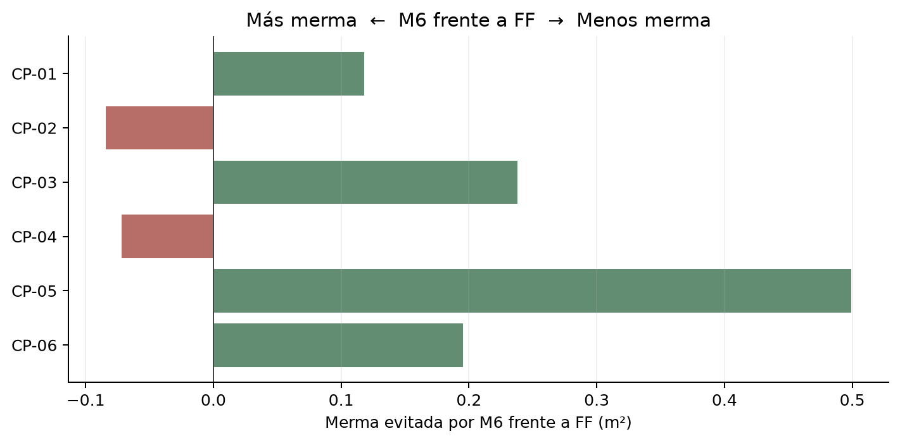
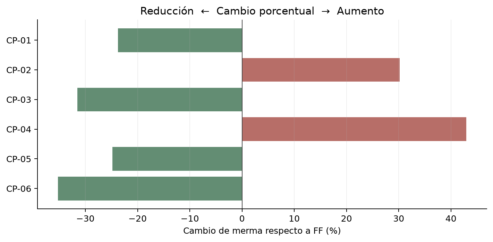
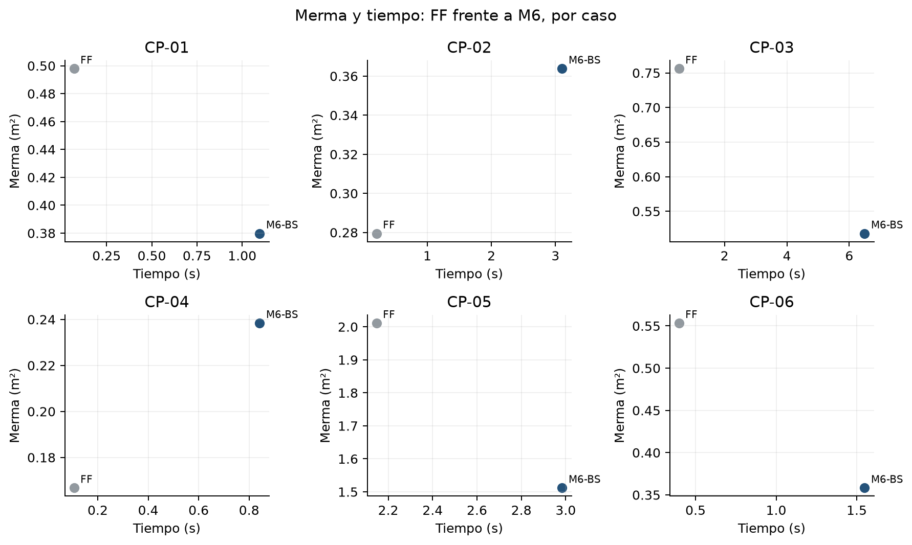
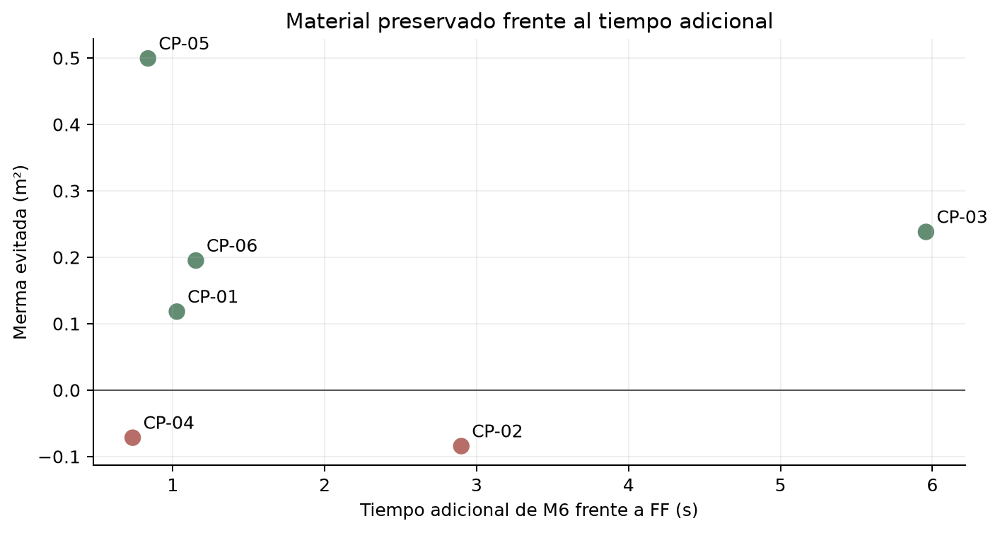
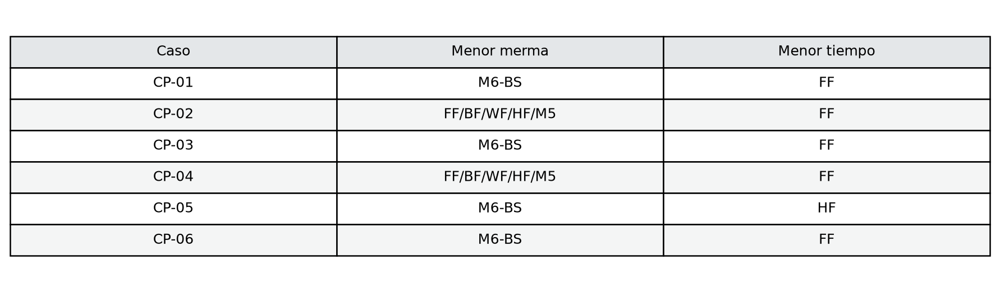
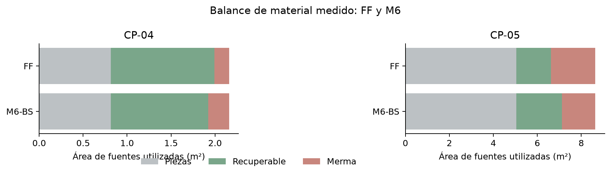

# Calidad y algoritmos — NewGlass
Andro Joseph Quispe Cesias · Sprint 2

## 1. Resumen ejecutivo
Se analizaron 270 mediciones de seis motores en nueve casos: seis comerciales y tres de regresión. Se excluyeron 54 calentamientos. Las 54 combinaciones caso-motor superaron la validación geométrica; en los seis casos comerciales todos colocaron el 100 % de las piezas.

**Hallazgo clave.** Dentro de cada caso comercial los seis motores tuvieron el mismo aprovechamiento y utilizaron la misma cantidad de fuentes. La diferencia principal estuvo en la organización del material residual, su área recuperable, la merma y el tiempo. El aprovechamiento por sí solo no basta para seleccionar un motor.

M6 redujo la merma frente a FF en cuatro casos y la aumentó en dos, con mayor tiempo mediano en los seis. No hay un ganador universal: la elección depende del escenario y de la prioridad entre material y velocidad.

| Caso | Prioridad material | Prioridad velocidad |
|---|---|---|
| CP-01 | M6-BS | FF |
| CP-02 | FF/BF/WF/HF/M5 | FF |
| CP-03 | M6-BS | FF |
| CP-04 | FF/BF/WF/HF/M5 | FF |
| CP-05 | M6-BS | HF |
| CP-06 | M6-BS | FF |

## 2. Cómo leer este informe
**A** es el área completa de las fuentes utilizadas; **P**, el área de las piezas colocadas; **R**, el área recuperable propuesta. Aprovechamiento = 100 × P / A; merma = A − P − R. Áreas grandes se expresan en m² (1 m² = 1 000 000 mm²).

**Merma no es 100 − aprovechamiento.** Esa diferencia incluye tanto recuperable como merma. Con la misma plancha y las mismas piezas, P y A son iguales: el aprovechamiento empata. Si una distribución deja un rectángulo recuperable mayor y otra fragmenta el sobrante, R cambia y también la merma. Es una explicación conceptual, no un patrón medido adicional.

## 3. Marco de medición ISO 25010 / ISO 25023
ISO/IEC 25010 orienta qué características de calidad evaluar; ISO/IEC 25023 aporta medidas para cuantificar calidad. Este informe presenta una evaluación cuantitativa alineada metodológicamente con ISO/IEC 25023. Cobertura y validez aportan evidencia de adecuación funcional, y el tiempo de comportamiento temporal. Aprovechamiento, merma y recuperable son métricas de dominio NewGlass que complementan esa evaluación. ISO no prescribe aquí la fórmula de merma y no se afirma certificación.

| Qué evaluar | Qué medimos | Fórmula / unidad | Para qué sirve |
|---|---|---|---|
| Adecuación funcional | Cobertura | 100 × colocadas / solicitadas (%) | Comprueba si se completa el pedido |
| Validez geométrica | Patrón válido | PASS / FAIL | Comprueba contención, no solapamiento, margen y separación |
| Comportamiento temporal | Tiempo mediano | ms o s | Mide el costo computacional observado |
| Calidad del corte | Merma | A − P − R (mm² o m²) | Material no colocado ni recuperable según el criterio aplicado |
| Reutilización | Recuperable | mm² o m² | Material potencialmente útil para futuros cortes |
| Eficiencia material | Aprovechamiento | 100 × P / A (%) | Proporción del área convertida en piezas |

## 4. Métricas
El recuperable es una propuesta conservadora: un rectángulo principal por fuente sujeto a dimensiones mínimas. No equivale a todo el residuo físicamente reutilizable. El tiempo incluye motor y cálculo de métricas en el adaptador, excluye callbacks, validación posterior y latencia HTTP; se informa la mediana de cinco mediciones, no tiempo de CPU.

## 5. Motores evaluados
| Motor | Idea principal | Cuándo podría aportar |
|---|---|---|
| FF | Primera colocación válida según su orden | Referencia rápida y simple |
| BF | Busca un ajuste más cerrado | Espacios con capacidades distintas |
| WF | Aplica su política de selección de espacios disponibles | Distribuciones con espacios grandes |
| HF | Intenta usar huecos existentes bajo límites | Piezas con huecos aprovechables |
| M5 | Considera el mejor residual libre | Alternativas con residuales distintos |
| M6-BS | Explora varias alternativas mediante Beam Search acotado | Cuando preservar material justifica mayor cómputo |

## 6. Diseño experimental
Cada caso/motor tuvo un calentamiento excluido y cinco repeticiones medidas en procesos nuevos, con orden rotado. Se verificaron hashes de entrada y resultados, y la geometría mediante un oráculo independiente de bits y enumeración residual. El ambiente y límites exactos están en results/manifest.json; se evaluó el backend identificado por su hash, sobre WSL2 compartido. La batería comercial usa raster de 1 mm, margen y separación de 3 mm y mínimo recuperable de 10 × 10 mm. No se repitió la batería en esta revisión.

## 7. Casos de prueba
CP-01 pequeño; CP-02 mediano; CP-03 grande acotado; CP-04 formas mixtas; CP-05 multi-plancha; CP-06 plancha y retazo. Los tres casos EXP son regresiones históricas y se presentan por separado. Los pedidos comerciales son sintéticos, no una muestra de clientes.

## 8. Resultados para tomar decisiones
| Caso | Mejor merma (m²) | Motor(es) | Más rápido | Tiempo (s) | Recomendación |
|---|---:|---|---|---:|---|
| CP-01 | 0.380 | M6-BS | FF | 0.070 | Material: M6; velocidad: FF |
| CP-02 | 0.279 | FF/BF/WF/HF/M5 | FF | 0.206 | Elegir FF en estas métricas |
| CP-03 | 0.518 | M6-BS | FF | 0.536 | Material: M6; velocidad: FF |
| CP-04 | 0.167 | FF/BF/WF/HF/M5 | FF | 0.106 | Elegir FF en estas métricas |
| CP-05 | 1.512 | M6-BS | HF | 1.788 | Material: M6; velocidad: HF |
| CP-06 | 0.358 | M6-BS | FF | 0.397 | Material: M6; velocidad: FF |

Figura 1. Merma evitada por M6 frente a FF. Valores positivos preservan material; CP-02 y CP-04 muestran que M6 también puede empeorar.

Figura 2. Cambio porcentual de merma: (M6 − FF) / FF × 100. Valores negativos representan reducciones; positivos, aumentos.

| Caso | Cambio M6 vs FF | Tiempo extra vs FF | Decisión |
|---|---:|---:|---|
| CP-01 | -23.7 % | +1.027 s / 15.7× | Considerar M6 por material |
| CP-02 | +30.2 % | +2.899 s / 15.1× | FF domina en merma y tiempo |
| CP-03 | -31.5 % | +5.958 s / 12.1× | Considerar M6 por material |
| CP-04 | +43.0 % | +0.736 s / 7.9× | FF domina en merma y tiempo |
| CP-05 | -24.8 % | +0.837 s / 1.4× | Considerar M6 por material |
| CP-06 | -35.3 % | +1.152 s / 3.9× | Considerar M6 por material |

## 9. Merma y recuperabilidad
En cada caso comercial A y P son iguales entre motores; por tanto, una diferencia de R corresponde a una diferencia opuesta de merma. La igualdad en número de fuentes no significa igualdad de disposición ni de recuperabilidad. **En palabras simples:** colocar las mismas piezas puede dejar sobrantes de utilidad distinta.

## 10. Costo temporal
Las medianas se comparan en segundos y también como multiplicadores, calculados sobre los tiempos de cada caso. No son predicciones de latencia en producción. Cinco repeticiones no permiten estimar percentiles robustos.

Figura 3. Merma y tiempo mediano de FF y M6 por caso. Las escalas son independientes entre paneles; CP-02 y CP-04 muestran que esperar más no siempre reduce merma.

## 11. Trade-off material vs tiempo

Figura 4. Merma evitada por M6 frente al tiempo adicional respecto de FF. Por encima de cero se preserva material; por debajo aumenta la merma. La conveniencia depende del valor del material y del tiempo disponible.

## 12. ¿Qué motor elegir?
**Regla práctica propuesta, limitada a los casos evaluados:** exigir primero validez y cobertura; si varios cumplen, comparar merma, recuperable, fuentes y tiempo. Si la diferencia de merma es relevante y el vidrio es costoso, considerar el motor que preserve más material; si es pequeña o inexistente, considerar el más rápido. No es una regla universal.

Figura 5. Matriz de decisión por caso: distingue menor merma de menor tiempo; los empates se muestran completos.

FF fue el más rápido en CP-01, CP-02, CP-03, CP-04 y CP-06; HF en CP-05. M6 ofrece la menor merma en CP-01, CP-03, CP-05 y CP-06. En CP-02 y CP-04 no existe ventaja experimental para seleccionar M6 bajo las métricas evaluadas: FF tiene menor merma y tiempo.

## 13. Casos representativos
**CP-05, favorable a M6.** HF: 2.011124 m² y 1.788 s; M6: 1.511784 m² y 2.984 s. M6 evita 0.499340 m² de merma a cambio de 1.196 s adicionales. Ambos colocaron las mismas piezas, usaron las mismas fuentes y lograron igual aprovechamiento. En palabras simples: esperar aproximadamente 1,2 s preservó casi medio metro cuadrado adicional bajo el criterio de recuperabilidad.

**CP-04, desfavorable a M6.** FF generó 0,166753 m² de merma en 0,106 s; M6 generó 0,238393 m² en 0,842 s. Una búsqueda más compleja no garantiza mejor solución. Estas cifras son medianas o valores del resumen, redondeados.

Figura 6. Balance de áreas medidas en CP-04 y CP-05. A igual área colocada y de fuentes, cambia el recuperable y, en sentido contrario, la merma. Son áreas agregadas, no dibujos de patrones de corte.

## 14. Evidencia real del sistema
Las capturas existentes muestran el comparador de seis motores, multi-plancha, plancha con retazo y trazabilidad. Las respuestas UI y su manifiesto están en ui/. Los tiempos de interfaz no se mezclan con las mediciones experimentales.

Comparador real de seis motores con datos sintéticos.

Vista real del caso multi-plancha.

Vista real de plancha y retazo.

Trazabilidad de material en el sistema.

## 15. Pruebas y validez
Los registros de tests/ documentan 568 pruebas unitarias y 88 API/persistencia aprobadas. La validación geométrica revisó contención, solapamiento, material, espesor, margen, separación, rotación, áreas y conteos. El oráculo comparte la rasterización canónica, por lo que no prueba geometría continua exacta.

## 16. Limitaciones
Nueve casos sintéticos y cinco mediciones por combinación no demuestran optimalidad ni rendimiento universal. FF, BF, WF, HF y M5 coincidieron en aprovechamiento y merma en los seis casos comerciales: esto no demuestra equivalencia general, sino que los casos no los discriminaron en esas métricas. El recuperable depende de mínimos y del rectángulo propuesto. Los tiempos dependen del entorno compartido. No existe modelo económico validado ni estimación de ahorro monetario.

## 17. Conclusiones
Los seis motores produjeron soluciones geométricamente válidas; todos completaron los pedidos comerciales. El aprovechamiento no diferenció motores dentro de cada caso, mientras merma y recuperable sí lo hicieron. M6 redujo merma en cuatro casos y la aumentó en dos, con mayor costo temporal. Una reducción puede justificar la espera según el contexto, pero no existe ganador universal. Se necesitan casos que discriminen las cinco heurísticas restantes y, posteriormente, costo por m² según tipo y espesor para estimar impacto económico.

**En palabras simples.** Los seis motores resolvieron los pedidos evaluados. La diferencia estuvo en cómo quedó el vidrio sobrante y cuánto tardaron. M6 conservó más material en varios escenarios, pero en otros tardó más y dejó más merma. La elección debe depender de si se prioriza material o rapidez.

## Anexo A — Resultados detallados
| Caso | Motor | Piezas | Aprovechamiento % | Merma mm² | Recuperable mm² | Fuentes | Mediana ms |
|---|---|---|---:|---:|---:|---:|---:|
| CP-01 | BF | 3/3 | 33.333 | 497919.0 | 942081.0 | 1 | 71 |
| CP-01 | FF | 3/3 | 33.333 | 497919.0 | 942081.0 | 1 | 70 |
| CP-01 | HF | 3/3 | 33.333 | 497919.0 | 942081.0 | 1 | 84 |
| CP-01 | M5 | 3/3 | 33.333 | 497919.0 | 942081.0 | 1 | 71 |
| CP-01 | M6-BS | 3/3 | 33.333 | 379746.0 | 1060254.0 | 1 | 1097 |
| CP-01 | WF | 3/3 | 33.333 | 497919.0 | 942081.0 | 1 | 73 |
| CP-02 | BF | 11/11 | 44.444 | 279492.0 | 2120508.0 | 1 | 347 |
| CP-02 | FF | 11/11 | 44.444 | 279492.0 | 2120508.0 | 1 | 206 |
| CP-02 | HF | 11/11 | 44.444 | 279492.0 | 2120508.0 | 1 | 507 |
| CP-02 | M5 | 11/11 | 44.444 | 279492.0 | 2120508.0 | 1 | 289 |
| CP-02 | M6-BS | 11/11 | 44.444 | 363810.0 | 2036190.0 | 1 | 3105 |
| CP-02 | WF | 11/11 | 44.444 | 279492.0 | 2120508.0 | 1 | 289 |
| CP-03 | BF | 24/24 | 45.833 | 756100.0 | 3923900.0 | 2 | 1299 |
| CP-03 | FF | 24/24 | 45.833 | 756100.0 | 3923900.0 | 2 | 536 |
| CP-03 | HF | 24/24 | 45.833 | 756100.0 | 3923900.0 | 2 | 1025 |
| CP-03 | M5 | 24/24 | 45.833 | 756100.0 | 3923900.0 | 2 | 1075 |
| CP-03 | M6-BS | 24/24 | 45.833 | 517920.0 | 4162080.0 | 2 | 6494 |
| CP-03 | WF | 24/24 | 45.833 | 756100.0 | 3923900.0 | 2 | 1108 |
| CP-04 | BF | 6/6 | 37.666 | 166752.8 | 1179672.0 | 1 | 136 |
| CP-04 | FF | 6/6 | 37.666 | 166752.8 | 1179672.0 | 1 | 106 |
| CP-04 | HF | 6/6 | 37.666 | 166752.8 | 1179672.0 | 1 | 272 |
| CP-04 | M5 | 6/6 | 37.666 | 166752.8 | 1179672.0 | 1 | 118 |
| CP-04 | M6-BS | 6/6 | 37.666 | 238392.8 | 1108032.0 | 1 | 842 |
| CP-04 | WF | 6/6 | 37.666 | 166752.8 | 1179672.0 | 1 | 115 |
| CP-05 | BF | 8/8 | 58.333 | 2011124.0 | 1588876.0 | 4 | 2704 |
| CP-05 | FF | 8/8 | 58.333 | 2011124.0 | 1588876.0 | 4 | 2147 |
| CP-05 | HF | 8/8 | 58.333 | 2011124.0 | 1588876.0 | 4 | 1788 |
| CP-05 | M5 | 8/8 | 58.333 | 2011124.0 | 1588876.0 | 4 | 2260 |
| CP-05 | M6-BS | 8/8 | 58.333 | 1511784.0 | 2088216.0 | 4 | 2984 |
| CP-05 | WF | 8/8 | 58.333 | 2011124.0 | 1588876.0 | 4 | 2004 |
| CP-06 | BF | 7/7 | 42.028 | 553307.0 | 1019193.0 | 2 | 428 |
| CP-06 | FF | 7/7 | 42.028 | 553307.0 | 1019193.0 | 2 | 397 |
| CP-06 | HF | 7/7 | 42.028 | 553307.0 | 1019193.0 | 2 | 428 |
| CP-06 | M5 | 7/7 | 42.028 | 553307.0 | 1019193.0 | 2 | 405 |
| CP-06 | M6-BS | 7/7 | 42.028 | 358224.0 | 1214276.0 | 2 | 1549 |
| CP-06 | WF | 7/7 | 42.028 | 553307.0 | 1019193.0 | 2 | 403 |
| EXP-COMPLEX-001 | BF | 24/24 | 29.598 | 746.7 | 184.0 | 6 | 136 |
| EXP-COMPLEX-001 | FF | 24/24 | 29.598 | 746.7 | 184.0 | 6 | 129 |
| EXP-COMPLEX-001 | HF | 24/24 | 29.598 | 746.7 | 184.0 | 6 | 134 |
| EXP-COMPLEX-001 | M5 | 24/24 | 29.598 | 731.7 | 199.0 | 6 | 131 |
| EXP-COMPLEX-001 | M6-BS | 24/24 | 29.598 | 698.7 | 232.0 | 6 | 366 |
| EXP-COMPLEX-001 | WF | 24/24 | 29.598 | 731.7 | 199.0 | 6 | 137 |
| EXP-MEDIUM-001 | BF | 9/9 | 28.413 | 193.9 | 66.0 | 3 | 44 |
| EXP-MEDIUM-001 | FF | 9/9 | 28.413 | 201.9 | 58.0 | 3 | 32 |
| EXP-MEDIUM-001 | HF | 9/9 | 28.413 | 201.9 | 58.0 | 3 | 33 |
| EXP-MEDIUM-001 | M5 | 9/9 | 28.413 | 201.9 | 58.0 | 3 | 33 |
| EXP-MEDIUM-001 | M6-BS | 9/9 | 28.413 | 196.9 | 63.0 | 3 | 95 |
| EXP-MEDIUM-001 | WF | 9/9 | 28.413 | 201.9 | 58.0 | 3 | 32 |
| EXP-SMALL-001 | BF | 3/3 | 60.000 | 0.0 | 8.0 | 2 | 19 |
| EXP-SMALL-001 | FF | 3/3 | 60.000 | 0.0 | 8.0 | 2 | 19 |
| EXP-SMALL-001 | HF | 3/3 | 60.000 | 0.0 | 8.0 | 2 | 20 |
| EXP-SMALL-001 | M5 | 3/3 | 60.000 | 0.0 | 8.0 | 2 | 20 |
| EXP-SMALL-001 | M6-BS | 3/3 | 60.000 | 0.0 | 8.0 | 2 | 26 |
| EXP-SMALL-001 | WF | 3/3 | 60.000 | 0.0 | 8.0 | 2 | 18 |

## Anexo B — Regresiones
EXP-SMALL-001, EXP-MEDIUM-001 y EXP-COMPLEX-001 usan sus JSON históricos y mínimos recuperables de 1 × 1 mm. Sus 18 combinaciones se incluyen en el anexo A; no se mezclan con las recomendaciones comerciales.

## Anexo C — Reproducción y archivos
Protocolo y casos: experiments/sprint2_quality/README.md. Entradas, hashes, tiempos y resultados por corrida: results/manifest.json, results/raw_results.csv y JSON individuales. Resumen: summary_results.csv. Referencias: https://www.iso.org/standard/78176.html y https://www.iso.org/standard/35747.html.

