# Calidad y algoritmos - Sprint 2

Andro Joseph Quispe Cesias

## Resumen ejecutivo

Se midieron 270 ejecuciones de seis motores productivos en 9 casos, con 54 calentamientos excluidos. La bateria utiliza cinco repeticiones por caso/motor.

## Objetivo y alcance

Comparar calidad de soluciones y tiempo computacional con entradas equivalentes. No se evaluan escalamiento horizontal, concurrencia de usuarios, seguridad ni latencia HTTP. Los casos comerciales son sinteticos; no representan pedidos de clientes.

## ISO 25010 / ISO 25023

Medicion alineada metodologicamente con ISO/IEC 25023:2016: tiempo como evidencia de comportamiento temporal; cobertura y validez como evidencia de adecuacion funcional en estos casos. Aprovechamiento y merma son metricas de dominio NewGlass, no formulas prescritas por ISO. No se declara certificacion ni identificadores normativos no comprobados.

ISO/IEC 25010:2023 define el modelo de calidad del producto; ISO/IEC 25023:2016 aporta medidas cuantitativas. Se usa esta distincion como marco metodologico, sin equiparar las metricas de vidrio a medidas normativas.

Referencias: [ISO/IEC 25023:2016](https://www.iso.org/standard/35747.html), [ISO/IEC 25010:2023](https://www.iso.org/standard/78176.html).

## Metricas y formulas

A = area completa de las fuentes utilizadas; P = area geometrica colocada; R = recuperable propuesto.

- Aprovechamiento = 100 * P / A (%).
- Merma = A - P - R (mm2); merma_pct_derivada = 100 * merma / A.
- Recuperable: un rectangulo principal por fuente, sujeto a minimos; no todo residuo reutilizable.
- Cobertura = 100 * placed_units / total_units.
- Tiempo: computation_time_ms del adaptador, motor + metricas, excluidos callbacks; no CPU ni HTTP.
- Fuentes: planchas, retazos y total de unidades fisicas.

## Diseno experimental y ambiente

Backend evaluado: `2afa9d72cecee74d4c61187ff15c74564e7dde3f`. Python: `3.11.17 (main, Oct 21 2026, 17:46:53) [Clang 23.1.3 ]`. SO: `Linux-6.18.33.2-microsoft-standard-WSL2-x86_64-with-glibc2.39`. CPU: AMD Ryzen 5 4500U with Radeon Graphics; 6 CPUs visibles.

Cada corrida usa un proceso nuevo, un problema reconstruido e identico hash de entrada para los seis motores. El hash incluye minimos residuales y politica externa. Un calentamiento separado por caso/motor; orden de motores rotado entre repeticiones. Limite externo 120 s y 256 MiB. BS-2 y limites nativos productivos sin cambios. Validacion posterior fuera del cronometro.

Se acelero el recorrido de bits del verificador tras detectar su coste en el calentamiento multi-plancha; se conserva la misma enumeracion exhaustiva y se prueba equivalencia con el original. Esto ocurre fuera del tiempo medido y no cambia los algoritmos. Los JSON identifican la variante acelerada; los anteriores usaron el oraculo original.

Comerciales: raster 1 mm, margen/separacion 3 mm, paso 5 grados, recuperacion minima 10 x 10 mm. Regresiones: JSON historico intacto y minimos 1 x 1 mm. No se mezclan ambos bloques en la tabla global.

## Casos de prueba

CP-01 pequeno; CP-02 mediano; CP-03 grande acotado (24 piezas); CP-04 formas mixtas; CP-05 multi-plancha; CP-06 plancha y retazo. EXP-SMALL/MEDIUM/COMPLEX-001 son regresiones controladas. Las dimensiones, cantidades y configuracion completas estan en los JSON versionados.

| Caso | Piezas | Fuentes disponibles | Margen / separacion mm | Raster mm | Paso grados | Minimo recuperable mm |
|---|---:|---:|---|---:|---:|---|
| CP-01 | 3 | 1 | 3 / 3 | 1 | 5 | 10 x 10 |
| CP-02 | 11 | 2 | 3 / 3 | 1 | 5 | 10 x 10 |
| CP-03 | 24 | 3 | 3 / 3 | 1 | 5 | 10 x 10 |
| CP-04 | 6 | 2 | 3 / 3 | 1 | 5 | 10 x 10 |
| CP-05 | 8 | 8 | 3 / 3 | 1 | 5 | 10 x 10 |
| CP-06 | 7 | 3 | 3 / 3 | 1 | 5 | 10 x 10 |
| EXP-COMPLEX-001 | 24 | 7 | 1 / 1 | 1 | 5 | 1 x 1 |
| EXP-MEDIUM-001 | 9 | 4 | 1 / 1 | 1 | 5 | 1 x 1 |
| EXP-SMALL-001 | 3 | 2 | 0 / 0 | 1 | 5 | 1 x 1 |

## Resultados por caso

| Caso | Motor | Piezas | Aprovechamiento % | Merma mm2 | Recuperable mm2 | Fuentes | Tiempo mediano ms |
|---|---|---|---:|---:|---:|---:|---:|
| CP-01 | BF | 3/3 | 33.333 | 497,919 | 942,081 | 1 | 71 |
| CP-01 | FF | 3/3 | 33.333 | 497,919 | 942,081 | 1 | 70 |
| CP-01 | HF | 3/3 | 33.333 | 497,919 | 942,081 | 1 | 84 |
| CP-01 | M5 | 3/3 | 33.333 | 497,919 | 942,081 | 1 | 71 |
| CP-01 | M6-BS | 3/3 | 33.333 | 379,746 | 1,060,254 | 1 | 1,097 |
| CP-01 | WF | 3/3 | 33.333 | 497,919 | 942,081 | 1 | 73 |
| CP-02 | BF | 11/11 | 44.444 | 279,492 | 2,120,508 | 1 | 347 |
| CP-02 | FF | 11/11 | 44.444 | 279,492 | 2,120,508 | 1 | 206 |
| CP-02 | HF | 11/11 | 44.444 | 279,492 | 2,120,508 | 1 | 507 |
| CP-02 | M5 | 11/11 | 44.444 | 279,492 | 2,120,508 | 1 | 289 |
| CP-02 | M6-BS | 11/11 | 44.444 | 363,810 | 2,036,190 | 1 | 3,105 |
| CP-02 | WF | 11/11 | 44.444 | 279,492 | 2,120,508 | 1 | 289 |
| CP-03 | BF | 24/24 | 45.833 | 756,100 | 3,923,900 | 2 | 1,299 |
| CP-03 | FF | 24/24 | 45.833 | 756,100 | 3,923,900 | 2 | 536 |
| CP-03 | HF | 24/24 | 45.833 | 756,100 | 3,923,900 | 2 | 1,025 |
| CP-03 | M5 | 24/24 | 45.833 | 756,100 | 3,923,900 | 2 | 1,075 |
| CP-03 | M6-BS | 24/24 | 45.833 | 517,920 | 4,162,080 | 2 | 6,494 |
| CP-03 | WF | 24/24 | 45.833 | 756,100 | 3,923,900 | 2 | 1,108 |
| CP-04 | BF | 6/6 | 37.666 | 166,752.8 | 1,179,672 | 1 | 136 |
| CP-04 | FF | 6/6 | 37.666 | 166,752.8 | 1,179,672 | 1 | 106 |
| CP-04 | HF | 6/6 | 37.666 | 166,752.8 | 1,179,672 | 1 | 272 |
| CP-04 | M5 | 6/6 | 37.666 | 166,752.8 | 1,179,672 | 1 | 118 |
| CP-04 | M6-BS | 6/6 | 37.666 | 238,392.8 | 1,108,032 | 1 | 842 |
| CP-04 | WF | 6/6 | 37.666 | 166,752.8 | 1,179,672 | 1 | 115 |
| CP-05 | BF | 8/8 | 58.333 | 2,011,124 | 1,588,876 | 4 | 2,704 |
| CP-05 | FF | 8/8 | 58.333 | 2,011,124 | 1,588,876 | 4 | 2,147 |
| CP-05 | HF | 8/8 | 58.333 | 2,011,124 | 1,588,876 | 4 | 1,788 |
| CP-05 | M5 | 8/8 | 58.333 | 2,011,124 | 1,588,876 | 4 | 2,260 |
| CP-05 | M6-BS | 8/8 | 58.333 | 1,511,784 | 2,088,216 | 4 | 2,984 |
| CP-05 | WF | 8/8 | 58.333 | 2,011,124 | 1,588,876 | 4 | 2,004 |
| CP-06 | BF | 7/7 | 42.028 | 553,307 | 1,019,193 | 2 | 428 |
| CP-06 | FF | 7/7 | 42.028 | 553,307 | 1,019,193 | 2 | 397 |
| CP-06 | HF | 7/7 | 42.028 | 553,307 | 1,019,193 | 2 | 428 |
| CP-06 | M5 | 7/7 | 42.028 | 553,307 | 1,019,193 | 2 | 405 |
| CP-06 | M6-BS | 7/7 | 42.028 | 358,224 | 1,214,276 | 2 | 1,549 |
| CP-06 | WF | 7/7 | 42.028 | 553,307 | 1,019,193 | 2 | 403 |
| EXP-COMPLEX-001 | BF | 24/24 | 29.598 | 746.72 | 184 | 6 | 136 |
| EXP-COMPLEX-001 | FF | 24/24 | 29.598 | 746.72 | 184 | 6 | 129 |
| EXP-COMPLEX-001 | HF | 24/24 | 29.598 | 746.72 | 184 | 6 | 134 |
| EXP-COMPLEX-001 | M5 | 24/24 | 29.598 | 731.72 | 199 | 6 | 131 |
| EXP-COMPLEX-001 | M6-BS | 24/24 | 29.598 | 698.72 | 232 | 6 | 366 |
| EXP-COMPLEX-001 | WF | 24/24 | 29.598 | 731.72 | 199 | 6 | 137 |
| EXP-MEDIUM-001 | BF | 9/9 | 28.413 | 193.86 | 66 | 3 | 44 |
| EXP-MEDIUM-001 | FF | 9/9 | 28.413 | 201.86 | 58 | 3 | 32 |
| EXP-MEDIUM-001 | HF | 9/9 | 28.413 | 201.86 | 58 | 3 | 33 |
| EXP-MEDIUM-001 | M5 | 9/9 | 28.413 | 201.86 | 58 | 3 | 33 |
| EXP-MEDIUM-001 | M6-BS | 9/9 | 28.413 | 196.86 | 63 | 3 | 95 |
| EXP-MEDIUM-001 | WF | 9/9 | 28.413 | 201.86 | 58 | 3 | 32 |
| EXP-SMALL-001 | BF | 3/3 | 60 | 0 | 8 | 2 | 19 |
| EXP-SMALL-001 | FF | 3/3 | 60 | 0 | 8 | 2 | 19 |
| EXP-SMALL-001 | HF | 3/3 | 60 | 0 | 8 | 2 | 20 |
| EXP-SMALL-001 | M5 | 3/3 | 60 | 0 | 8 | 2 | 20 |
| EXP-SMALL-001 | M6-BS | 3/3 | 60 | 0 | 8 | 2 | 26 |
| EXP-SMALL-001 | WF | 3/3 | 60 | 0 | 8 | 2 | 18 |

## Resumen global comercial

Las areas se ponderan por area utilizada sumada sobre un resultado representativo de cada caso. Tiempo: mediana de las medianas de los seis casos; no latencia de una carga agregada. Cobertura: piezas colocadas totales / solicitadas totales. Solo casos comerciales.

| Motor | Casos completos | Aprovechamiento % | Merma mm2 (suma) | Recuperable mm2 (suma) | Cobertura % | Tiempo mediano ms |
|---|---:|---:|---:|---:|---:|---:|
| FF | 6/6 | 47.476 | 4,264,694.8 | 10,774,230 | 100 | 301.5 |
| BF | 6/6 | 47.476 | 4,264,694.8 | 10,774,230 | 100 | 387.5 |
| WF | 6/6 | 47.476 | 4,264,694.8 | 10,774,230 | 100 | 346 |
| HF | 6/6 | 47.476 | 4,264,694.8 | 10,774,230 | 100 | 467.5 |
| M5 | 6/6 | 47.476 | 4,264,694.8 | 10,774,230 | 100 | 347 |
| M6-BS | 6/6 | 47.476 | 3,369,876.8 | 11,669,048 | 100 | 2,266.5 |

## Hallazgos y comparacion de motores

Resultados funcionalmente deterministas en 54 de 54 combinaciones caso/motor. Validacion satisfactoria en 54 de 54 combinaciones.

No se anadio CP-07: CP-01..06 ya proporcionan diferencias de disposicion y merma con entradas comerciales. No se seleccionaron solamente ejecuciones favorables.

Los seis motores tienen el mismo aprovechamiento dentro de cada caso comercial. Las diferencias de merma proceden de la disposicion y del recuperable, no de una mejora del aprovechamiento.

En palabras simples: cortar la misma cantidad de vidrio no significa dejar sobrantes igual de utiles.

FF y BF coinciden en las metricas de calidad (sin exigir tiempos iguales) en: CP-01, CP-02, CP-03, CP-04, CP-05, CP-06.

CP-01 - Mayor aprovechamiento (%): BF, FF, HF, M5, M6-BS, WF, 33.333.
CP-01 - Mayor recuperable (mm2): M6-BS, 1,060,254.
CP-01 - Menos fuentes: BF, FF, HF, M5, M6-BS, WF, 1.
CP-01 - Menor tiempo mediano (ms): FF, 70.
### CP-01

Menor merma: M6-BS, 379,746 mm2. M6-BS frente a FF: 0 puntos porcentuales de aprovechamiento, -118,173 mm2 de diferencia de merma y 15.671 veces el tiempo mediano.

En palabras simples: todos completaron las piezas. Beam dejo menos merma, pero hay que considerar su coste temporal.

CP-02 - Mayor aprovechamiento (%): BF, FF, HF, M5, M6-BS, WF, 44.444.
CP-02 - Mayor recuperable (mm2): BF, FF, HF, M5, WF, 2,120,508.
CP-02 - Menos fuentes: BF, FF, HF, M5, M6-BS, WF, 1.
CP-02 - Menor tiempo mediano (ms): FF, 206.
### CP-02

Menor merma: BF, FF, HF, M5, WF, 279,492 mm2. M6-BS frente a FF: 0 puntos porcentuales de aprovechamiento, 84,318 mm2 de diferencia de merma y 15.073 veces el tiempo mediano.

En palabras simples: todos completaron las piezas. Beam no redujo la merma respecto de First Fit en este caso; un algoritmo mas complejo no garantiza una mejora.

CP-03 - Mayor aprovechamiento (%): BF, FF, HF, M5, M6-BS, WF, 45.833.
CP-03 - Mayor recuperable (mm2): M6-BS, 4,162,080.
CP-03 - Menos fuentes: BF, FF, HF, M5, M6-BS, WF, 2.
CP-03 - Menor tiempo mediano (ms): FF, 536.
### CP-03

Menor merma: M6-BS, 517,920 mm2. M6-BS frente a FF: 0 puntos porcentuales de aprovechamiento, -238,180 mm2 de diferencia de merma y 12.116 veces el tiempo mediano.

En palabras simples: todos completaron las piezas. Beam dejo menos merma, pero hay que considerar su coste temporal.

CP-04 - Mayor aprovechamiento (%): BF, FF, HF, M5, M6-BS, WF, 37.666.
CP-04 - Mayor recuperable (mm2): BF, FF, HF, M5, WF, 1,179,672.
CP-04 - Menos fuentes: BF, FF, HF, M5, M6-BS, WF, 1.
CP-04 - Menor tiempo mediano (ms): FF, 106.
### CP-04

Menor merma: BF, FF, HF, M5, WF, 166,752.8 mm2. M6-BS frente a FF: 0 puntos porcentuales de aprovechamiento, 71,640 mm2 de diferencia de merma y 7.943 veces el tiempo mediano.

En palabras simples: todos completaron las piezas. Beam no redujo la merma respecto de First Fit en este caso; un algoritmo mas complejo no garantiza una mejora.

CP-05 - Mayor aprovechamiento (%): BF, FF, HF, M5, M6-BS, WF, 58.333.
CP-05 - Mayor recuperable (mm2): M6-BS, 2,088,216.
CP-05 - Menos fuentes: BF, FF, HF, M5, M6-BS, WF, 4.
CP-05 - Menor tiempo mediano (ms): HF, 1,788.
### CP-05

Menor merma: M6-BS, 1,511,784 mm2. M6-BS frente a FF: 0 puntos porcentuales de aprovechamiento, -499,340 mm2 de diferencia de merma y 1.39 veces el tiempo mediano.

En palabras simples: todos completaron las piezas. Beam dejo menos merma, pero hay que considerar su coste temporal.

CP-06 - Mayor aprovechamiento (%): BF, FF, HF, M5, M6-BS, WF, 42.028.
CP-06 - Mayor recuperable (mm2): M6-BS, 1,214,276.
CP-06 - Menos fuentes: BF, FF, HF, M5, M6-BS, WF, 2.
CP-06 - Menor tiempo mediano (ms): FF, 397.
### CP-06

Menor merma: M6-BS, 358,224 mm2. M6-BS frente a FF: 0 puntos porcentuales de aprovechamiento, -195,083 mm2 de diferencia de merma y 3.902 veces el tiempo mediano.

En palabras simples: todos completaron las piezas. Beam dejo menos merma, pero hay que considerar su coste temporal.

## Graficos

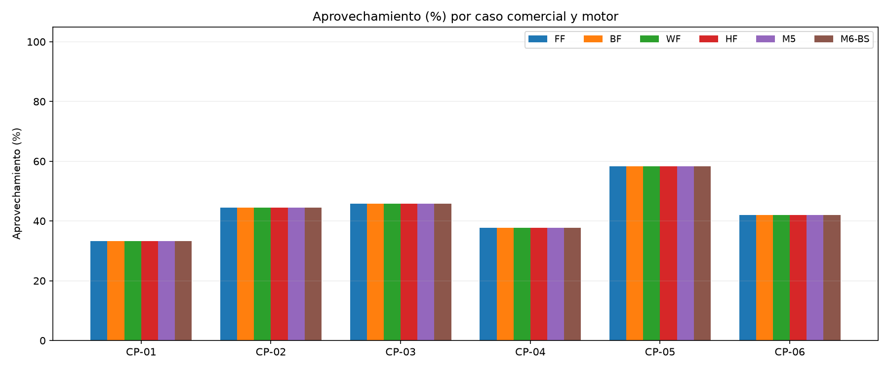
Figura 1. Aprovechamiento (%) por caso comercial; cinco repeticiones por motor.

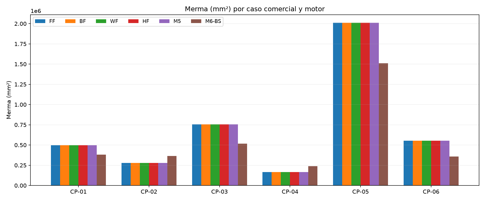
Figura 2. Merma (mm²) por caso comercial; cinco repeticiones por motor.

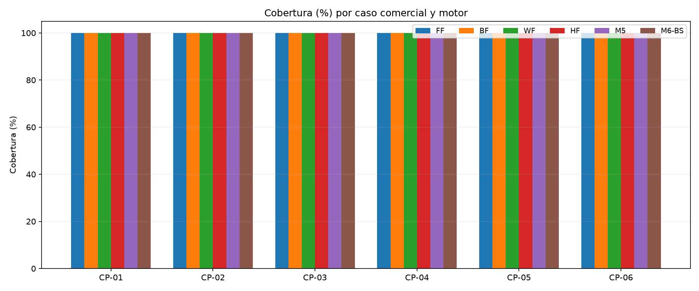
Figura 3. Cobertura (%) por caso comercial; cinco repeticiones por motor.

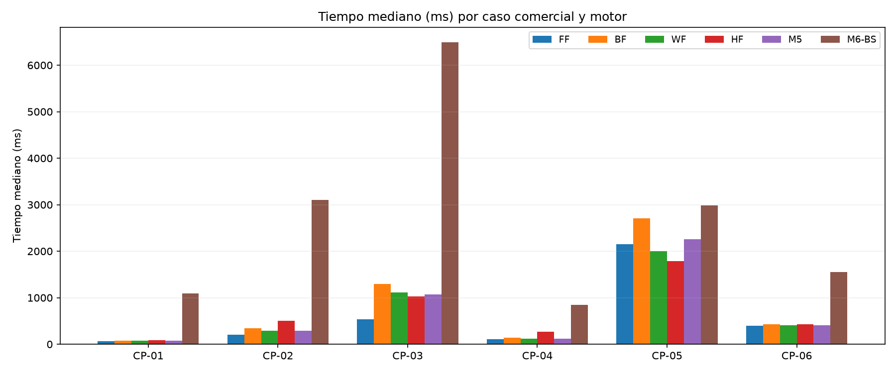
Figura 4. Tiempo mediano (ms) por caso comercial; cinco repeticiones por motor.

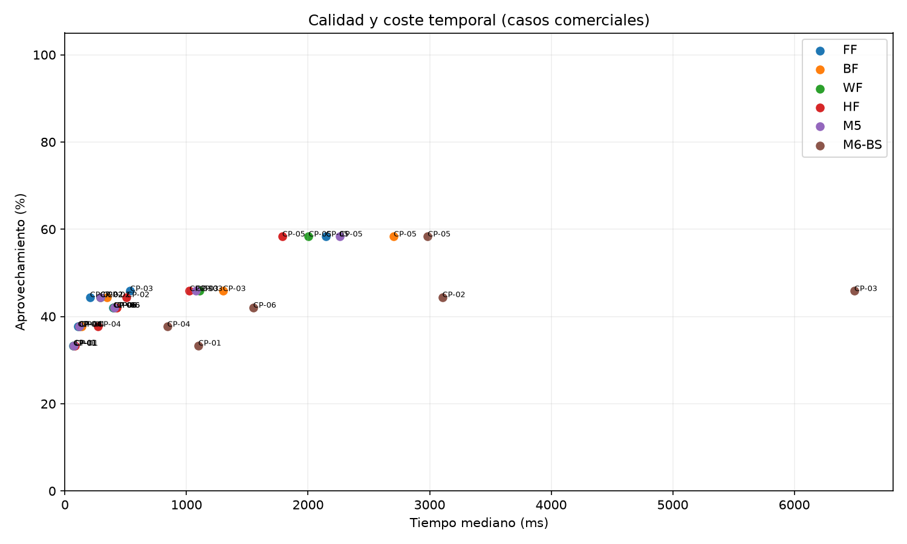
Figura 5. Cada punto representa un caso/motor; ejes lineales desde cero.

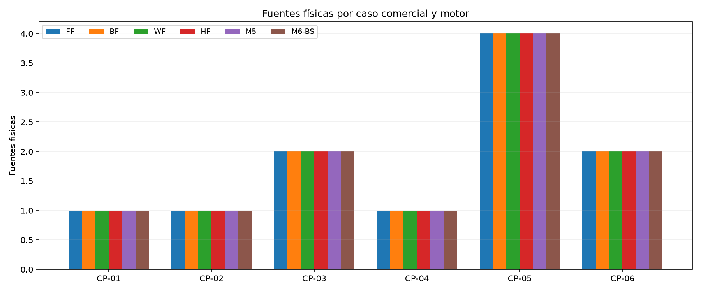
Figura 6. Fuentes físicas por caso comercial; cinco repeticiones por motor.

## Evidencias reales del sistema

Las capturas y respuestas HTTP del comparador V2 se registran en `screenshots/` y `ui/`. Esta validacion usa PostgreSQL temporal propio, sin confirmacion de cortes. Los tiempos UI no se mezclan con la bateria. El manifiesto UI identifica comparaciones y relacion con casos.

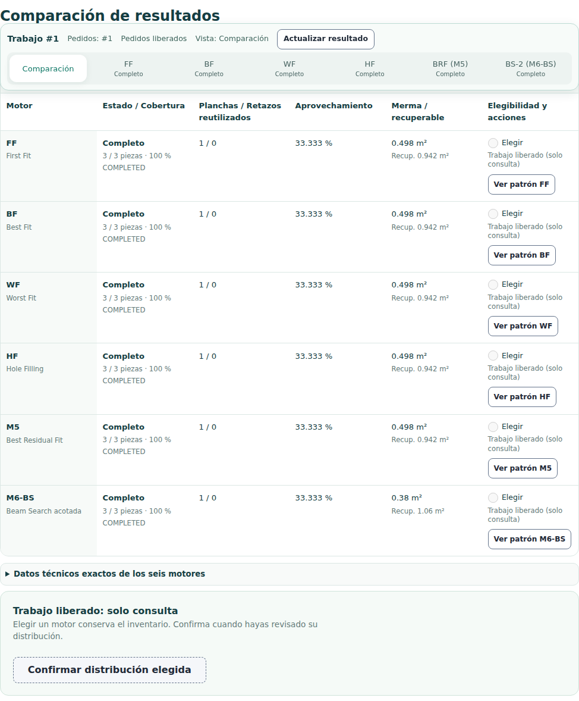
Figura 7. 01-comparacion-seis-motores. Interfaz real y datos sinteticos.

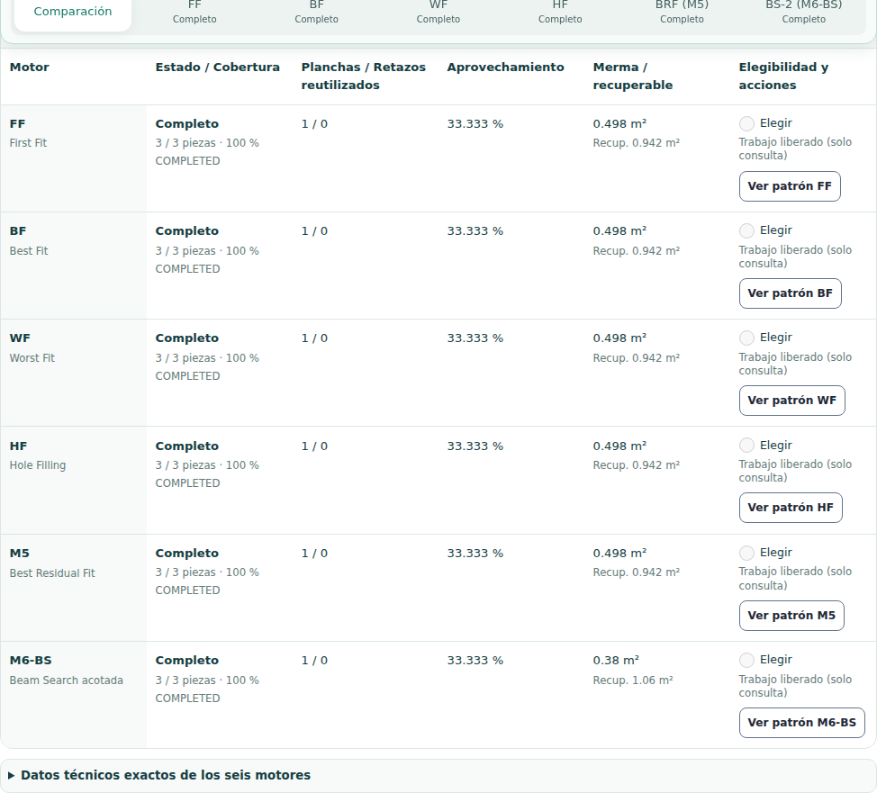
Figura 8. 02-tabla-completa. Interfaz real y datos sinteticos.

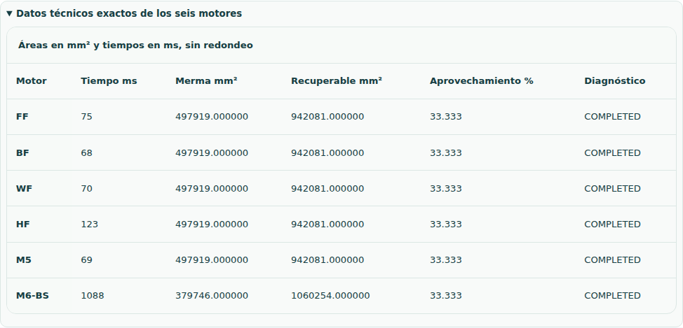
Figura 9. 03-datos-tecnicos. Interfaz real y datos sinteticos.

Figura 10. 04-configuracion. Interfaz real y datos sinteticos.

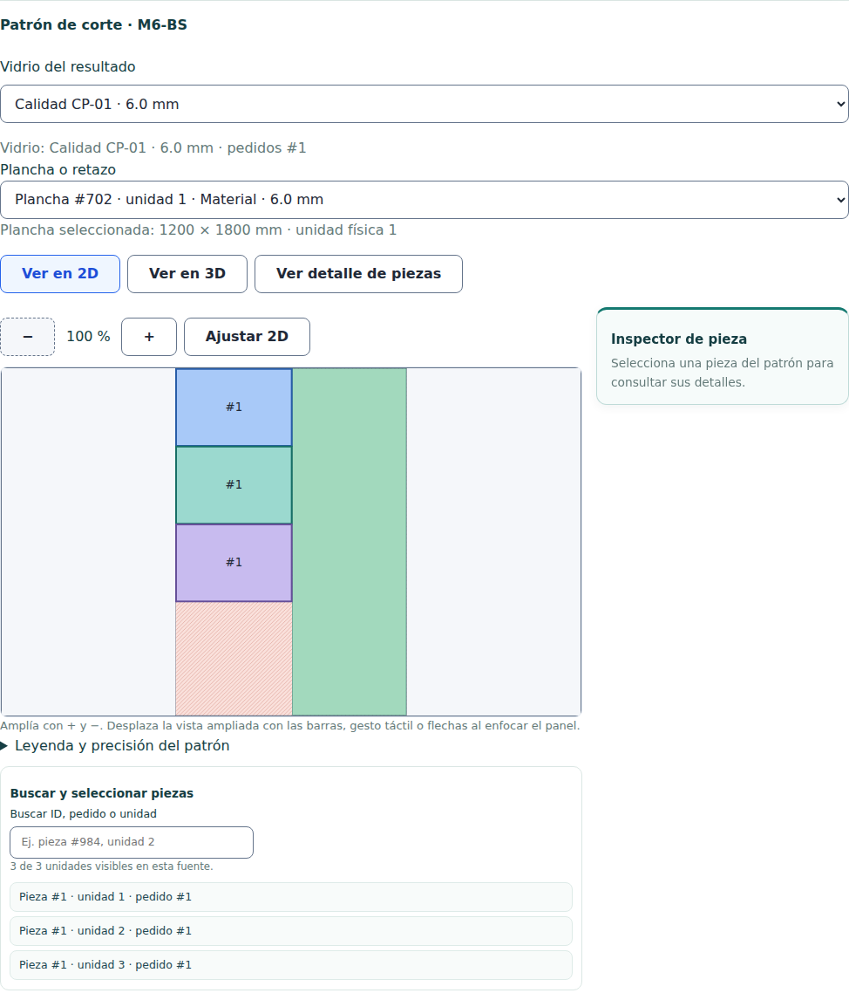
Figura 11. 05-patron-diferenciador-M6. Interfaz real y datos sinteticos.

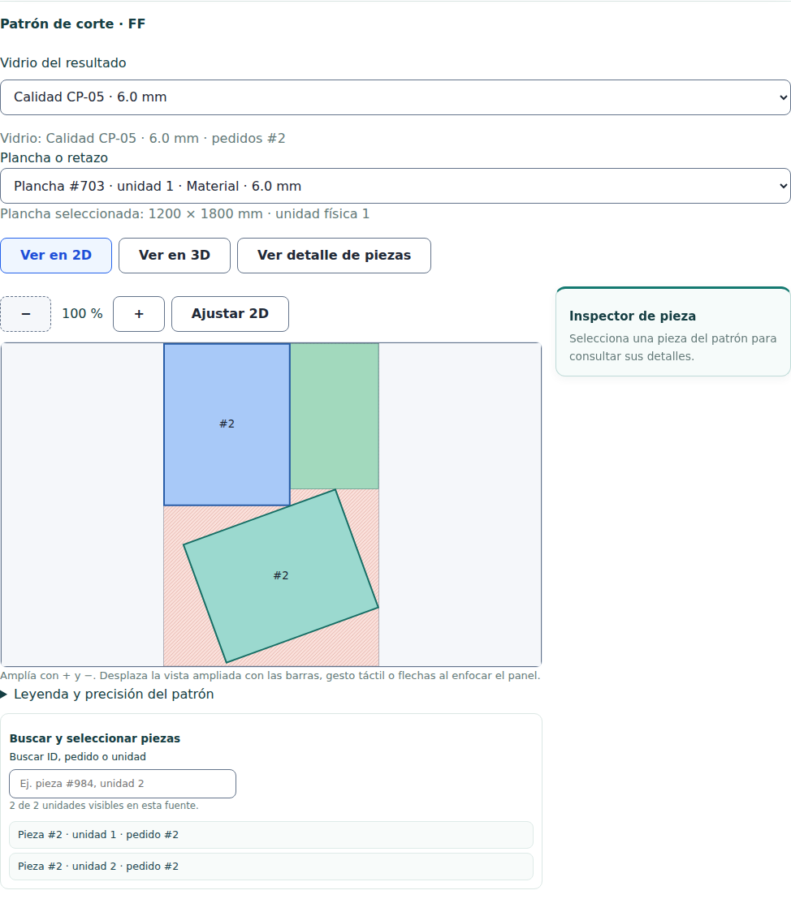
Figura 12. 06-multi-plancha. Interfaz real y datos sinteticos.

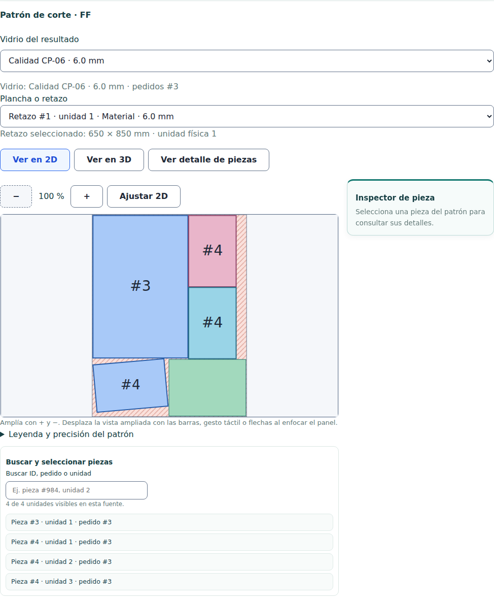
Figura 13. 07-plancha-retazo. Interfaz real y datos sinteticos.

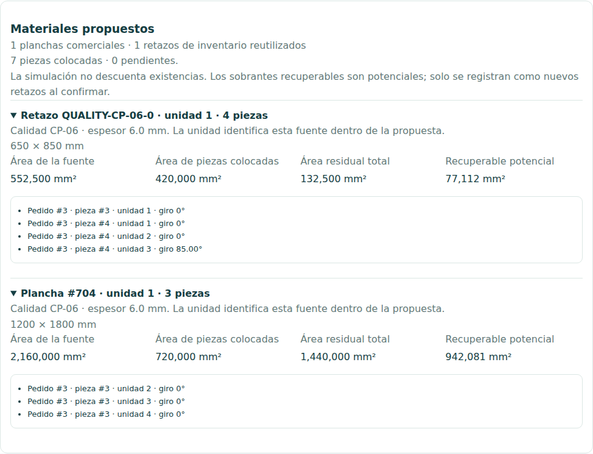
Figura 14. 08-trazabilidad-material. Interfaz real y datos sinteticos.

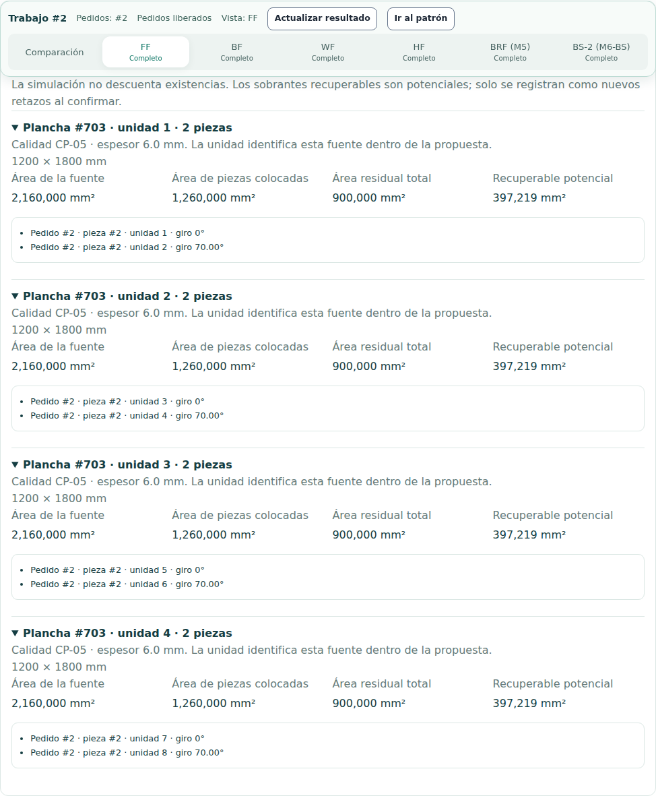
Figura 15. 09-fuentes-multi-plancha. Interfaz real y datos sinteticos.

## Pruebas y validez

Cada resultado medido se valida con un oraculo independiente de bits y enumeracion residual. Revisa contencion, solapamiento, material, espesor, margen, separacion, rotacion, areas y conteos. Los logs de regresion y JUnit estan en `tests/`. No confundir una prueba existente con una prueba ejecutada: consultar esos resultados.

## Limitaciones

- Nueve casos sinteticos; no estima calidad universal ni optimalidad global.
- Cinco muestras por combinacion: se informa mediana/minimo/maximo, sin p95.
- Un entorno WSL2 compartido con el host; no es hardware dedicado ni tiempo CPU.
- El oraculo reutiliza rasterizacion canonica; no prueba geometria continua exacta.
- Area recuperable conservadora y dependiente de minimos; regresiones separadas.
- Los tiempos enteros en ms pueden ser cero en casos muy pequenos.
- El README general y algunos comentarios historicos describen V1/deadlines antiguos; prevalece el codigo auditado.

## Conclusiones

La seleccion debe considerar validez y cobertura antes de aprovechamiento, merma y tiempo. Las diferencias observadas son por caso: no justifican un mejor motor absoluto. Los resultados no se completaron con datos historicos ni con ejecuciones de otro sistema operativo.

## En palabras simples

Se entrego el mismo trabajo a los seis motores. Se conto cuanto vidrio usaron, que parte quedo recuperable y cuanto tardaron. Las tablas permiten elegir segun el caso; mas tiempo de busqueda no asegura menos desperdicio.

## Anexos y reproduccion

Protocolo y comandos: `../../../../experiments/sprint2_quality/README.md`. Datos por corrida, hashes, parametros y dependencias: `results/manifest.json`, `results/raw_results.csv` y JSON individuales. Resumen: `summary_results.csv`.

## Resultado de suites ejecutadas

- api.xml: 88 pruebas; 0 fallos; 0 errores; 0 omitidas.
- unit.xml: 568 pruebas; 0 fallos; 0 errores; 0 omitidas.

Las selecciones unitarias y API/persistencia son disjuntas. Los reintentos no se suman. Incidencias de preparacion y correcciones de pruebas: `tests/README.md`.

